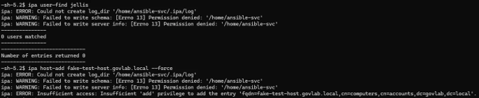
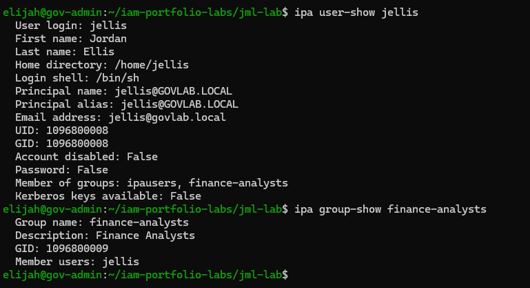
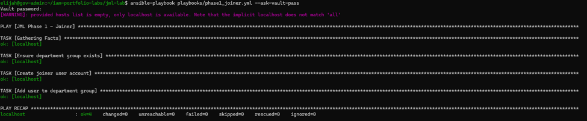
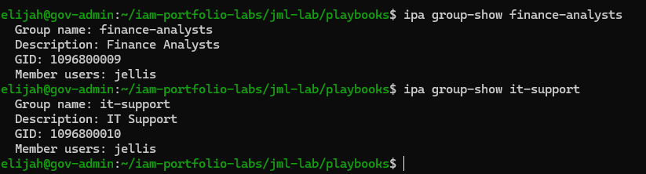
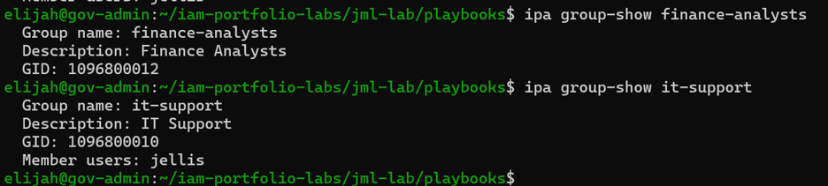
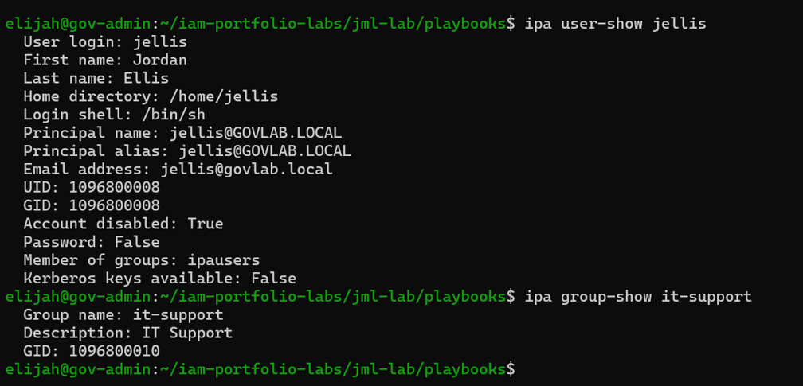
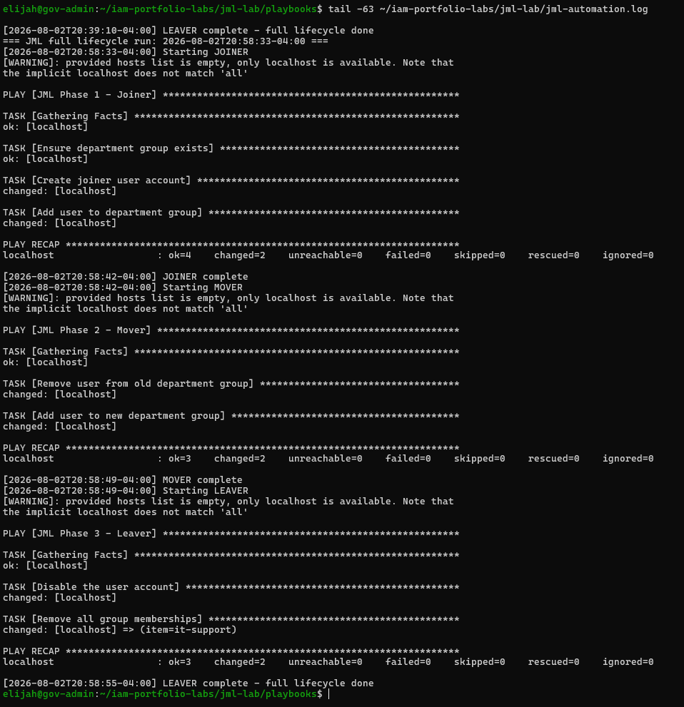

# Lab 1: JML Automation (Ansible + FreeIPA)

Automates the Joiner-Mover-Leaver identity lifecycle against an on-prem FreeIPA directory for one test persona, Jordan Ellis (`jellis`).

| Stage | What the playbook does | File |
|---|---|---|
| Joiner | Creates the user and adds them to `finance-analysts` | [playbooks/phase1_joiner.yml](playbooks/phase1_joiner.yml) |
| Mover | Removes `finance-analysts`, adds `it-support` | [playbooks/phase2_mover.yml](playbooks/phase2_mover.yml) |
| Leaver | Disables the account, removes group memberships, revokes Vault SSH leases | [playbooks/phase3_leaver.yml](playbooks/phase3_leaver.yml) |

[run_full_lifecycle.sh](run_full_lifecycle.sh) runs all three phases in order, checks each phase's exit code, and stops on the first failure. [jml-automation.log](jml-automation.log) is the output of a clean full run.

## Screenshots

**Post 3: Joiner and least-privilege service account**

`ansible-svc` can query users but is denied when it tries to create a host, showing the role is scoped to users and groups only.

The Joiner creates `jellis` and adds them to `finance-analysts`.

**Post 4: Mover, broken versus fixed**

Broken: `jellis` holds both `finance-analysts` and `it-support`, the stale access a mover keeps when removal doesn't happen.

Fixed: the old group is removed and the new group is added.

**Post 5: Leaver**

The account is disabled and its group memberships are removed.

**Post 6: Full lifecycle**

`run_full_lifecycle.sh` runs Joiner, Mover, and Leaver in sequence.

## Files
- [DESIGN.md](DESIGN.md): scope, persona, and what each stage changes in FreeIPA
- [TROUBLESHOOTING.md](TROUBLESHOOTING.md): broken-versus-fixed log, including the group-deletion bug
- [vars/secrets.example.yml](vars/secrets.example.yml): template only; real secrets are Ansible Vault-encrypted and gitignored

## Least privilege
The Joiner runs as `ansible-svc`, a FreeIPA service account with a custom "JML Automation Operator" role (User Administrators and Group Administrators only). A write test (`ipa host-add`) confirmed it cannot create hosts.

## Known lab shortcuts
- **Mover and Leaver run under the operator's own `kinit admin` ticket**, not `ansible-svc`. That gives them broader rights than they need. In production they would run under the same scoped service account as the Joiner.
- **`failed_when: rc not in [0, 1]`** lets an "already done" result (for example, the user was not in the group) pass so reruns don't fail. The tradeoff is that a real no-op passes silently. The fix is a follow-up `ipa group-show` check that asserts the expected membership.
