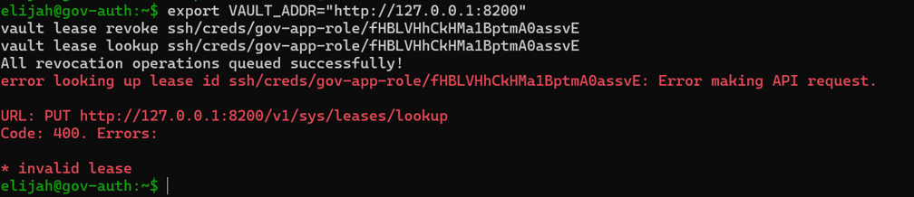
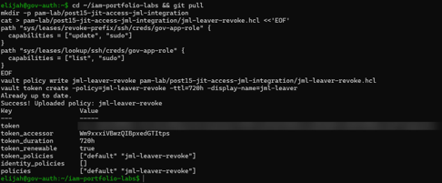

# Post 15 — Revoking Access: Tying PAM Back to the JML Leaver

## What I did
- **Revoked an issued SSH credential by hand.** Took an outstanding OTP lease under `ssh/creds/gov-app-role`, revoked it with `vault lease revoke`, then looked it up again. Vault returned `400 invalid lease`, confirming the credential no longer exists.
- **Wrote a narrowly scoped policy for automation** ([jml-leaver-revoke.hcl](jml-leaver-revoke.hcl)). It allows exactly two things: revoking leases under `gov-app-role` (`revoke-prefix`) and listing them to confirm none remain (`lookup`). Vault requires `sudo` on both paths. It has no access to secrets, other roles, or Vault configuration.
- **Issued a token with only that policy** (`display_name = jml-leaver`) for the JML Leaver playbook to use instead of the root token.
- **Added revocation to offboarding.** The Leaver in [Lab 1](../../jml-lab/) now disables the user in FreeIPA, removes their groups, revokes every outstanding Vault SSH lease for `gov-app-role`, and checks that the lease list comes back empty before reporting PASS.

## Screenshots

## Known lab shortcuts (not how I'd run production)
- **Long-lived automation token:** the `jml-leaver` token has a 720h TTL and is renewable. Production would use AppRole or another machine auth method with short-lived tokens.
- **Revocation isn't per-person:** `gov-app-role` is shared, so `revoke-prefix` revokes *everyone's* outstanding OTPs for that role, not just the leaver's. Per-identity roles or signed SSH certificates would let offboarding target one person. (This is the gap flagged in Post 14.)
- **Plain HTTP** to Vault, as in Post 14.

## Why it matters
Disabling an account in the directory doesn't end access that was already issued. A one-time password requested before termination is still a valid key to Gov-App until it's used or expires. Offboarding has to close the identity *and* the privileged access path, and this is where the JML lab and the PAM lab become one process: the Leaver can't report success until Vault confirms there's nothing left to revoke.
